# Tic Tac Toe: MinMax, Alpha-Beta Pruning and Heuristic Evaluation

This section walks through the process of building a tic-tac-toe AI using the minmax algorithm, alpha-beta pruning, and a heuristic evaluation function.

I'll go through each component in the order they were actually built: starting with MinMax itself, then alpha-beta pruning, then the heuristic evaluation function, and finally how all of these come together to let the AI determine which move gives it the best chance of winning.

## Vocabulary

Some terms used to describe the process of the MinMax algorithm and Alpha Beta prunning

| Term | Definition |
|------|------------|
| Snapshot / Board | A frozen moment of the game showing the full board state, including whose turn it is. Every board in the game tree is a snapshot. | 
| Level / Depth | A layer of the game tree representing how many simulated moves ahead we are looking. Level 0 is the current board; each deeper level represents one more simulated move. Turns alternate each level. | 
| AI Move | A board where it is the AI’s turn to act. Shown in red in the diagram. | 
| Player Move | A board where it is the human player’s turn to act. Shown in blue in the diagram. | 
| Child Board | A board that branches directly from a parent board, representing one simulated move from that parent’s board state. | 
| Sibling Boards | Boards that share the same parent. Each sibling represents a distinct simulated move from the same parent board. | 
| Leaf Board | A board at the end of a branch. Either because the game ended or because the search level limit was reached. In the diagram, this is Level 3. Shown in the diagram as white. |
| Score | A number representing how good a snapshot is for the AI. Positive favors AI; negative favors human. Leaf Boards get direct scores; internal boards get scores from their children. |
| Max Board / Min Board | Max boards represent AI turns and choose the highest child score. Min boards represent human turns and choose the lowest child score. Red boards are max; blue Boards are min. |
| Internal Boards | Any board that is neither the root or a leaf. |

---
## Understanding the MinMax algorithm

This algorithm is the "*brain*" behind the AI opponent in this game. It how our AI thinks ahead and determines which move it should take *like a human player*. It works by imagining every possible way the rest of the game could play out, assuming that **both the ai and human player always play their best possible move**. 

No player will throw the game or play badly on purpose. **Both will play to win**.

---
### Visualizing MinMax as a True of Future Moves
---
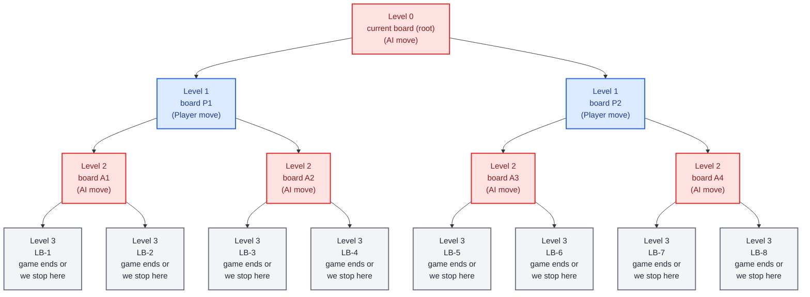

To understand how MinMax works, imagine pulling out your smartphone and taking a picture of a chessboard mid-game. 

*What does that photo tell you?* 
It captures where every piece currently sits, which spaces are empty, and whose turn it is next. Each *board* in this diagram represents a single snapshot of the game at one moment in time. 

You can think of MinMax as a map of future game paths, starting from the current board and branching outward.

MinMax **simulates** future moves that both itself and the human player can take. 

Each new *board* on the diagram comes from applying a **simulated move** to the board before it. That move creates a new path, which can then split into further branches as more moves are simulated.

For example, imagine it's the human's turn: from a single board, they might have two different options, like placing their mark in the left column or the right column. Each option becomes its own child board, since each one leads to a different result. *Two siblings boards are never the same and each represent a distinct move*.

As we move down the tree, we traverse different *levels* at a time. For each level, we alternate between both participants.

- **Level 0** (the top of the tree/root): the current game state/board, before the simulated move is performed for either participant. In our diagram, this is the AI's position (red).
- **Level 1**: all possible moves the human could make from the Level 0 board. Each move creates a new branch in the tree (blue).
- **Level 2**: for every Level 1 board, all possible moves the AI could make in response. Each of these responses creates another layer of branches (red).
- **Level 3**: all possible moves the human could make in response to each Level 2 board. This is our leaf level, where either the game has ended our we decided to stop.

The tree will keep branching and growing deeper until one of two things happens:
1. **A game ending simulated board/snapshot is reached** — someone has won or the game has ended in a draw.
2. **We choose to stop early at a specific level** — because searching all the way to the end of the game is often too slow for larger games.
---
### How Do Scores Move Up the Tree?
---
For the AI to actually work, every board in the tree needs a score. 

Let's look at our game tree again, now with example scores added to the leaf boards.


Our leaf boards will always be scored **directly** and **first** since each one represents a finished game or we've stopped looking any further ahead. To score every level above the leaf board, we need to ask one question at each board. 

**Whose turn does this board represent? The AI or the human player's?**

This answer tells us whether the board is a max board or a min board, which will later tell us how to pull a score up from its children.

---
#### Scoring the AI's Turn (Max Boards)
---

Since we know the AI always plays optimally, it will always choose whichever move leads to the *best* outcome for itself. So for any max board, we look at all of its children and return **highest** score between siblings.

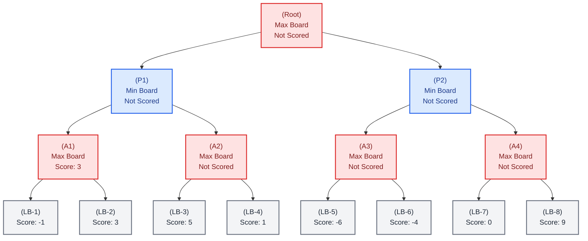

Take a look at `A1`, the leftmost AI board. Its two children, `LB-1` and `LB-2`, have scores `-1` and `3` respectively. Since `LB-2` is the higher of the two, `A1` takes that score.

This is the **"Max"** half of MiniMax. At every AI board, we take the *maximum* score among its children.

We repeat this same process for the rest of the AI boards in this level `(A2, A3, A4)`, each one taking the highest score from its own two children:

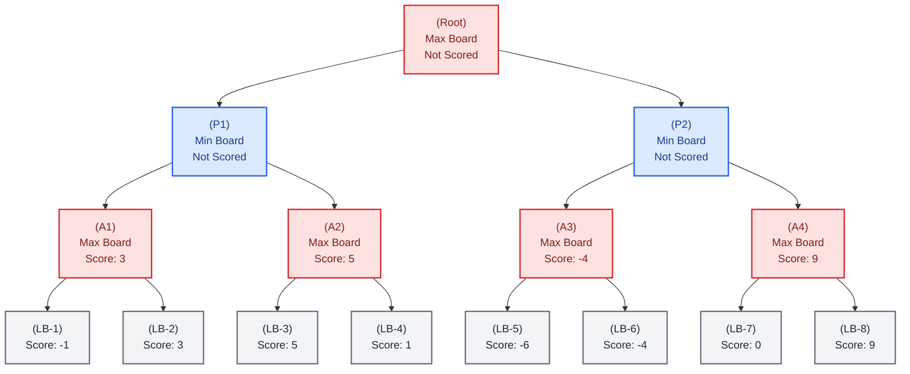
---
#### Scoring the Human's Turn (Min Board)
---

Now we move up one more level, to `P1` and `P2`. At this stage, it's the human player's turn. Since we assume the human plays optimally, they'll choose whichever move gives them the best chance of winning. In other words, whichever move hurts the AI's chances the most.

*So what score should the human's board take from its children?*

**Every score in this tree is measured from the AI's perspective**, no matter whose turn a board represents. A positive score means the position favors the AI. A negative score means it favors the human. This perspective never flips. It's the same point of view at every board in the tree.

So when it's the human's turn, they're viewing it from their own perspective. They're looking through the lens of the AI, and picking whichever option is worst for the it.

That's why min boards take the lowest score among their children, the same way max boards take the highest. Both are just applying "the AI's perspective" consistently, one from the side that wants the number as high as possible, the other from the side that wants it as low as possible.

By simulating the human's best moves (lowest scores), the AI is effectively asking: "If I end up here, what's the worst the human can do to me?" Once it knows that worst case (lowest score) for every option, it can pick whichever move leads to the best guaranteed outcome. Whether to win or avoiding to lose against it's opponent.

This alternation is exactly where the algorithm gets its name. **Max** on the AI's turns, **Min** on the human's turns, used together, all the way down the tree. This ensures the AI's final choice already accounts for the opponent's best possible offense, rather than assuming the human will make a lucky or weak move.

Here's the fully scored tree:

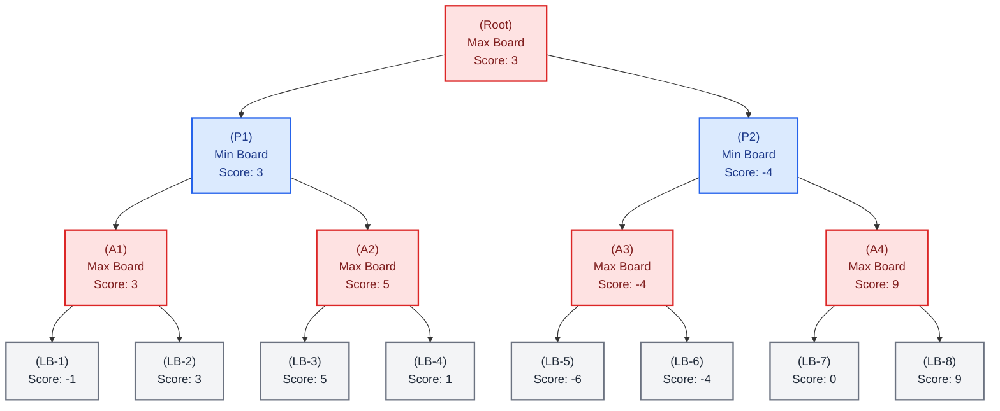
---
### Turning a Score Into an Actual Move
---

The root's score ends up being 3. However, this number isn't the move itself. To find the actual move the AI should make, we trace back down to whichever immediate child of the root produced that winning score.

Here, the root took the maximum between `P1 = 3` and `P2 = -4`. So `3` came from `P1`. The AI will make a move that leads to the `P1` board. This is the real move made in the actual game.

Everything below `P1` in the tree (the human's possible responses, and the AI's responses after that) isn't executed yet. It's only used to help determine how good the `P1` move is. Once the human actually responds, the AI will build a brand new tree from that resulting board and run this same scoring process all over again.

---
### How would the MinMax look in pseudocode?
---
*This is the plain MinMax function*

```js
const minMax = (board, level, maxAiPlayer, aiMarker, humanMarker) => {
    // If level === 0 or Any gameOver condition is met:
        // Call and return score of the current board from evaluation function (not implemented yet)

    // Define all available moves that can be performed for the human and AI. (Spaces that are not occupied by a mark)

    // If it's the AI's turn:
        //Define the highest score as a negative extreme
        // Loop through each available move and perform the following:
            // Simulate a move using the available move (should return a simulated board)
            // Find the score of the current simulated board with a recursive call to
            // minMax(), going down a level, switching to the human's turn and passing in the marks
            // Find whether the highest score needs to be updated by comparing the
            // current simulated board's score and the highest score
        // Once we finish looping, return the highest score

    // else: (if it's the human's turn)
    /// Define the lowest score as a positive extreme
    /// Follow the same format as the AI's turn, but find the lowest score
    /// among the children, going down a level and switching
    /// back to the AI's turn during recursion
}
```
---
## Understanding Alpha Beta Pruning

Right now, our MinMax function works great for small games. Tic tac toe can easily handle it. *But what happens when the game itself is much bigger?* For a game like chess, MinMax by itself isn't efficient since it searches every possible simulated board at each level to score them. This includes boards that lead to a bad move. 

Each level has the potential to produce an exponential number of boards, which we want to avoid.

So we'll implement alpha-beta pruning to solve this issue. Alpha beta pruning provides a shortcut to find the most optimal path by allowing us to skip scoring boards or branches that lead to bad moves.

### How does Alpha Beta Pruning Work?

Let's look at our original game tree from the MinMax section.

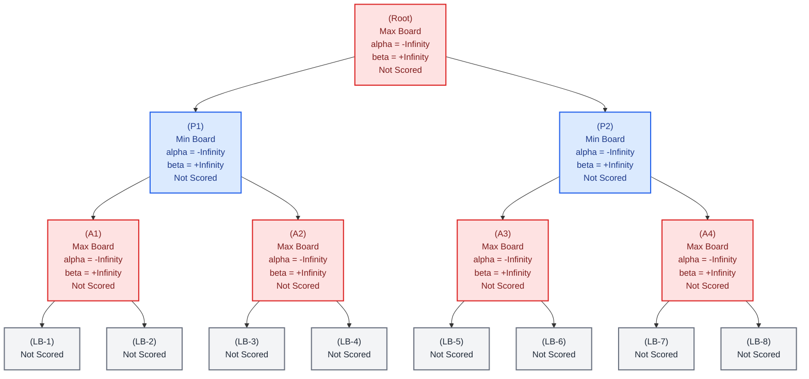

MinMax has worked correctly up to this point, but it had no way to keep track of the best scores found so far while exploring the tree. This meant the algorithm was forced to evaluate every branch, even ones that led to bad moves.

Our diagram now has special values called `alpha` and `beta`. 
- `alpha` - keeps track of the best score the AI has found so far (Max Boards)
- `beta` - keeps track of the best score the human has found so far (Min Boards)

Every board except the leaves has its own `alpha` and `beta`.

`alpha` and `beta` both start at extreme values: -Infinity and +Infinity, respectively.

*But why start at such extreme values?*

At the start, neither the AI nor the human has found anything yet. There's no "best score so far" to speak of. Starting alpha at -Infinity and beta at +Infinity guarantees that the very first real score either player finds will always count as an improvement, no matter how bad that score might actually be.

This matters because of how pruning actually gets decided. Every time a board's alpha or beta gets updated, we check is `alpha >= beta`?

If so, the remaining branches from that board get skipped (pruned) since we already know they can't change the outcome. Starting both `alpha` and `beta` at their extremes ensures this check can never accidentally trigger before either side has explored anything. Nothing gets pruned before it's had a real chance to be considered.

Here are a few things to keep in mind before we see alpha beta pruning in action.

>- `Score` within our diagrams will always be returned UP the tree to the closest parent from the child
>- `alpha` and `beta` values are always (*inherited*) passed down the tree, from a parent to its children, before those children have been explored.
>- Once a child returns its score, the parent updates its own alpha or beta based on that score. The value that gets updated depends on whether the parent is a Max board (`alpha`) or a Min board (`beta`)

Now let's look at alpha beta pruning in action.

> [!IMPORTANT]
> Green highlighted boards represent the board we're currently on

---

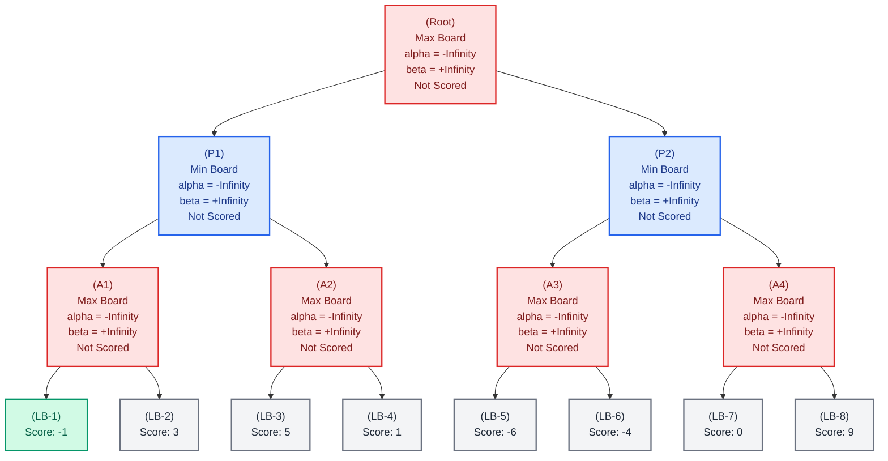
**Step 1**

In the previous MinMax section, it was mentioned that "leaf boards will always be scored **directly** and **first**". Because of this, leaf boards never need `alpha` or `beta` since their score is already given with nothing left to compare. `alpha` or `beta`. It only matters every board between the root and leaf board which are internal boards. These boards are responsible for comparing scores as they get returned upward all the way to the root.

`L1` is a leaf board with a score of `-1`, so we return its score straight to the parent.

---


**Step 2**

We use `L1`'s score to update `A1`'s score, which in turn updates the `alpha` value, since `A1` is a Max board.

Now we make the comparison: is `alpha >= beta`? `-1` is not `>=` `+Infinity`, so we move on to `A1`'s next child.

> [!IMPORTANT]
> Unlike normal MinMax, alpha beta pruning doesn't wait for every child to be scored before comparing. Instead, we compare after each child returns a score because `alpha` or `beta` already represent the best score found so far. This allows us to prune early if a branch can no longer affect the final decision.

---

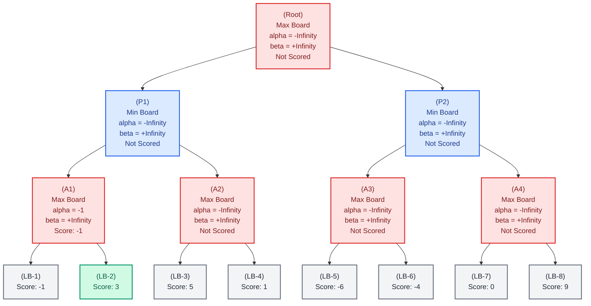
**Step 3**

`L2` has a score of `3`, so we return it straight to `A1`.

---

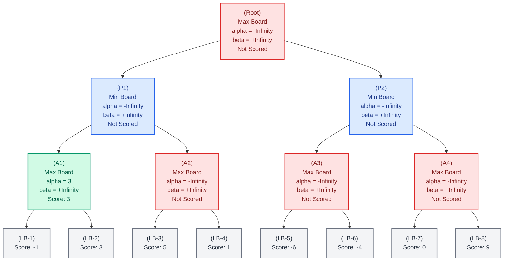

**Step 4**

`A1`'s previous score was `-1`. Since `L2`'s returned score `3` is higher than `A1`'s score, it updates to `3` and its `alpha` updates to match.

`A1` has no more children, so its final score of `3` simply gets returned up to its parent `P1`.

---

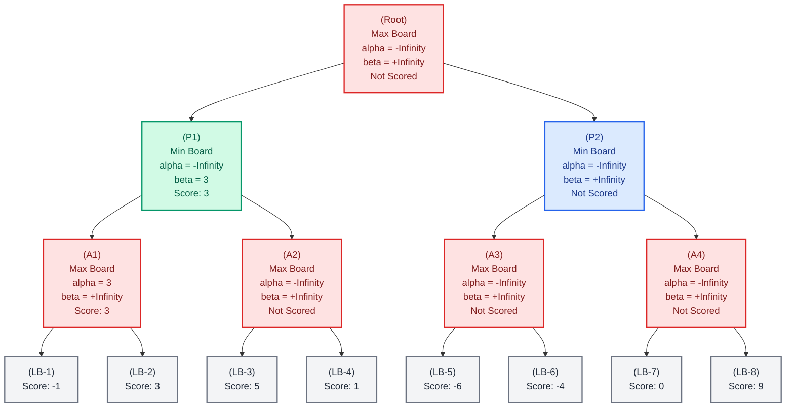

**Step 5**

`P1` receives `A1`'s score and updates its own score. Since `P1` is a Min board, its beta value is updated as well.

We perform the `alpha >= beta`. `-Infinity` is not `>=` `3`, so we move on to the next available child `A2`.

---

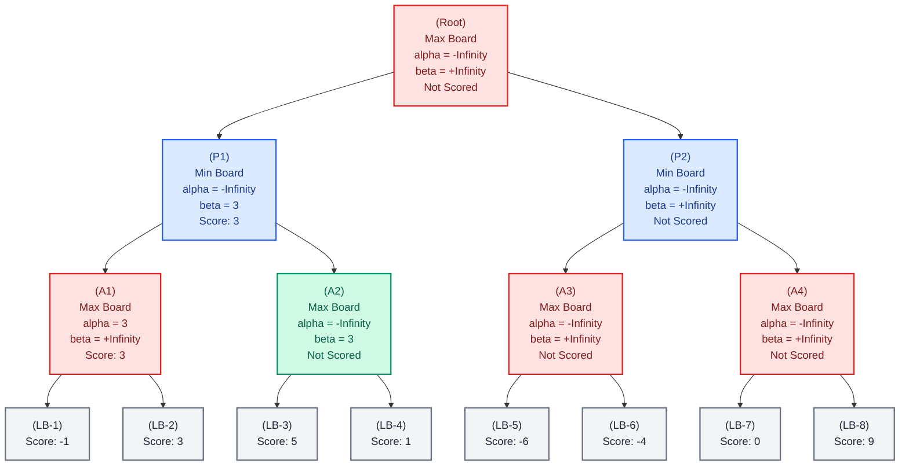

**Step 6**

`A2` inherits both the `alpha` and `beta` values of `P1`. `alpha` doesn't change, but `beta` inherits `3` from its `parent`'s `beta` value.

We move down to the next available board `L3`.

---

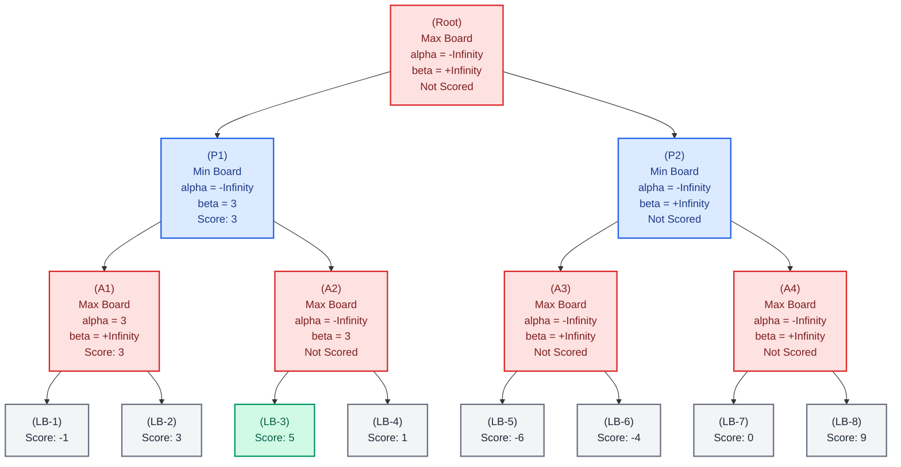

**Step 7**

Once again, we arrive at a leaf board. So `L3`'s score of `5` will be returned to it's parent `A2`

---

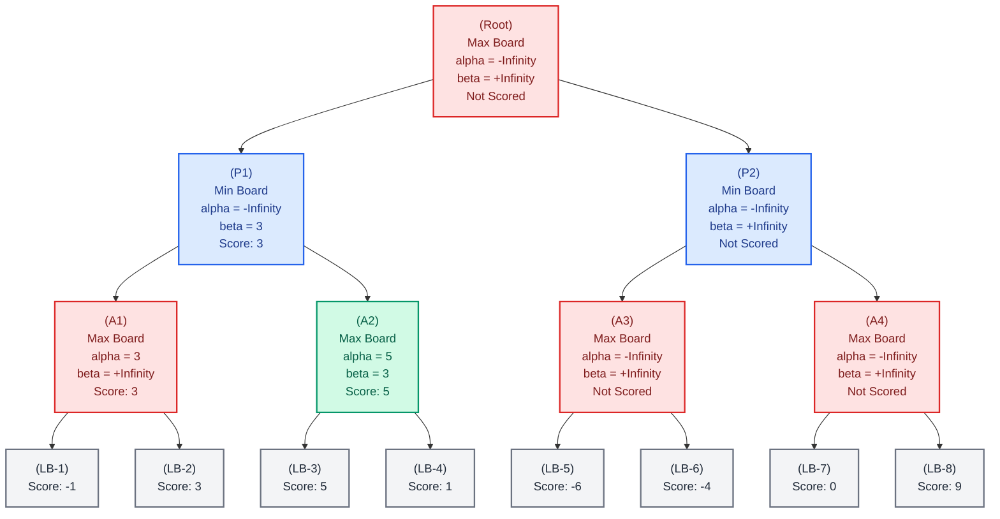
**Step 8**

`A2` receives `L3`'s returned score of `5` and updates its own score. As a result, its `alpha` value also updates.

Now we check is `alpha >= beta`? **YES**. So `A2` stops immediately and never looks at `L4` at all. We can prune it entirely.

---

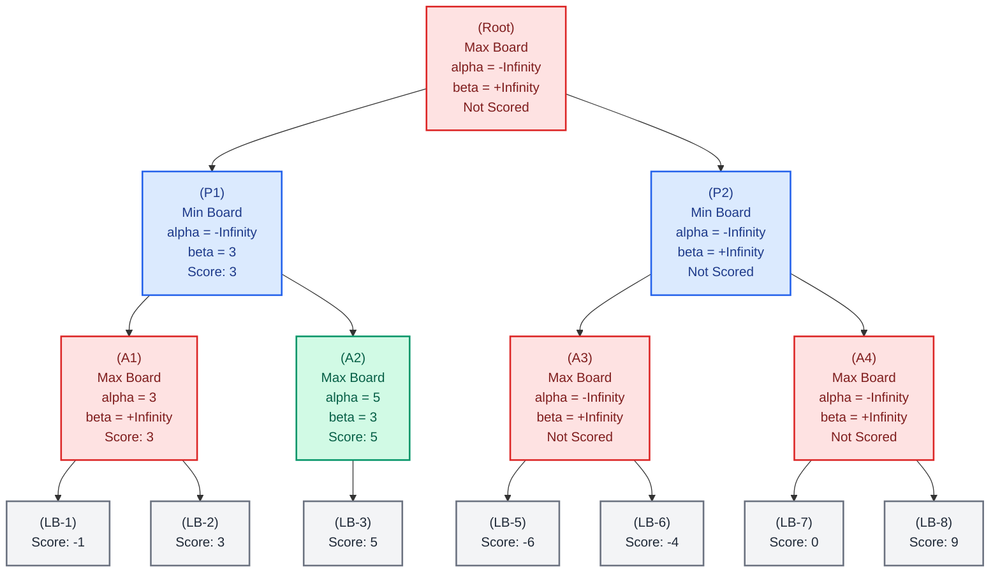

**Step 9**

This is our first `prune`. With `L4` eliminated and no more children, `A2` will send it's score to its parent `P1`.

---

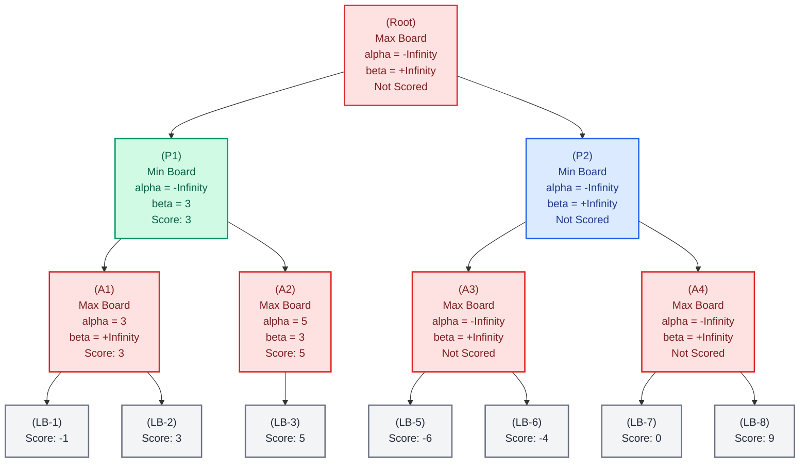

**Step 10**

`P1` receives `A2`'s score of `5` and determines the minimum between its current score `3` and the returned score `5`. Since `3` is smaller than `5`, its current score is not updated.

It performs the `alpha >= beta` check. `-Infinity` is not `>=` `3`, so nothing happens.

With no more children, `P1` sends its score to the `Root`.

---

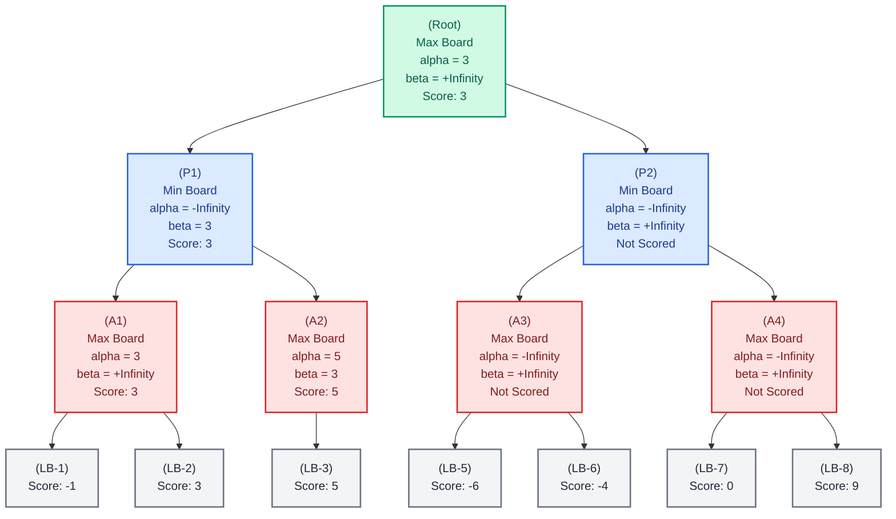

**Step 11**

`Root` receives `P1`'s score of `3`. `Root` is a Max board, so its `alpha` value updates to `3`. We perform the `alpha >= beta` check. `3` is not `>=` `+Infinity`, so we move on to `Root`'s next available child `P2`.

The rest of the diagram below will walk through each step until we arrive at another prune.

---

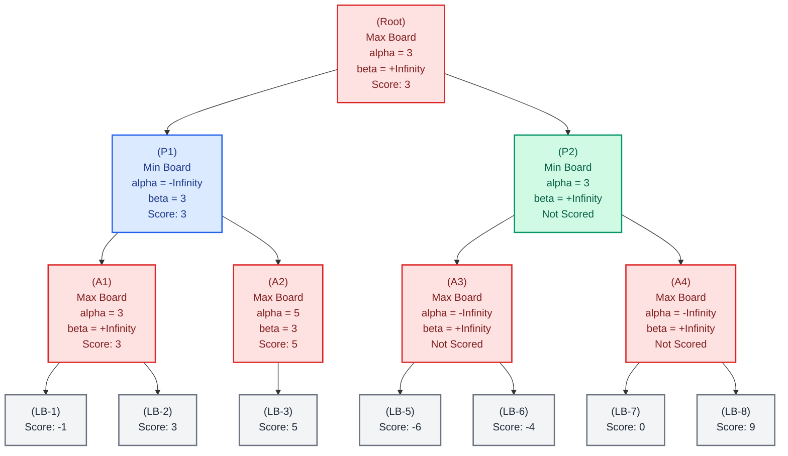
**Step 12**

`P2` inherits `alpha = 3` and `beta = +Infinity` from the `Root`.

---

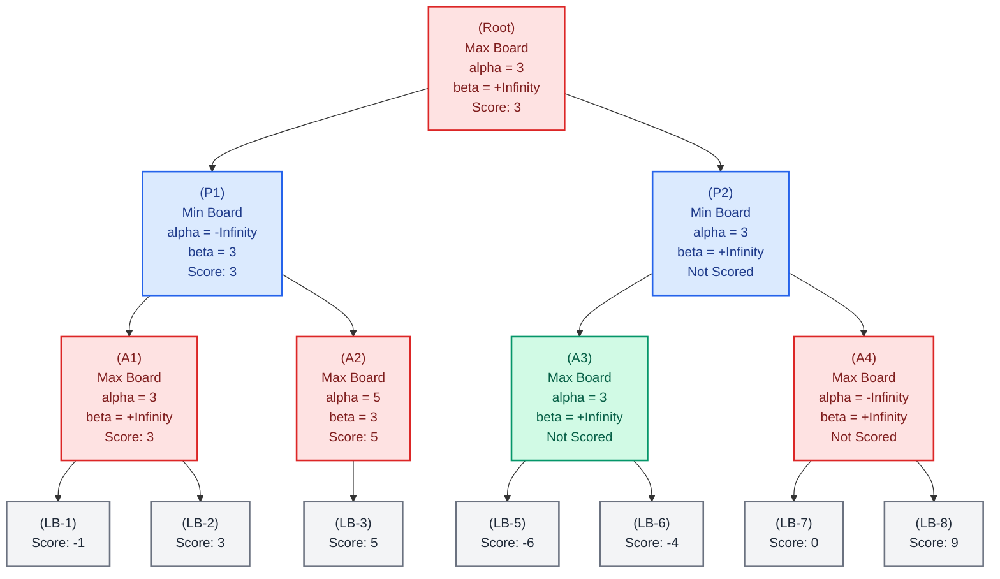
**Step 13**

`A3` inherits `alpha = 3` and `beta = +Infinity` from `P2`.

---

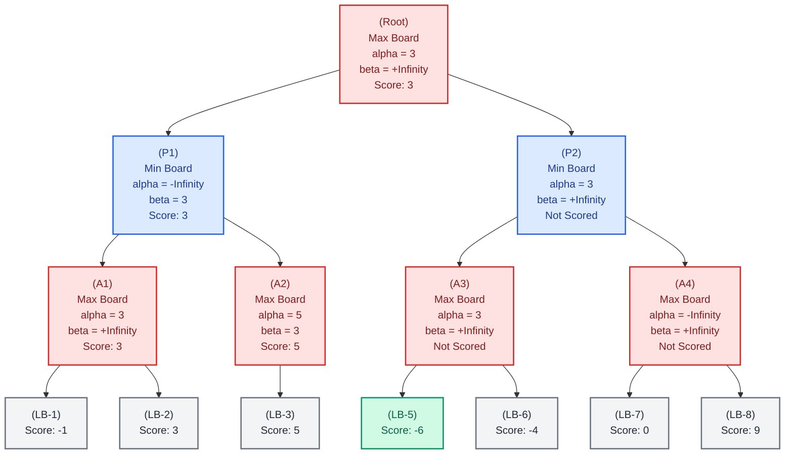
**Step 14**

`L5` returns `-6` to it's parent `A3`. 

---

```mermaid
flowchart TD
    Root["(Root)<br/>Max Board<br/>alpha = 3<br/>beta = +Infinity<br/>Score: 3"]:::ai --> P1["(P1)<br/>Min Board<br/>alpha = -Infinity<br/>beta = 3<br/>Score: 3"]:::player
    Root --> P2["(P2)<br/>Min Board<br/>alpha = 3<br/>beta = +Infinity<br/>Not Scored"]:::player

    P1 --> A1["(A1)<br/>Max Board<br/>alpha = 3<br/>beta = +Infinity<br/>Score: 3"]:::ai
    P1 --> A2["(A2)<br/>Max Board<br/>alpha = 5<br/>beta = 3<br/>Score: 5"]:::ai
    P2 --> A3["(A3)<br/>Max Board<br/>alpha = 3<br/>beta = +Infinity<br/>Score: -6"]:::greenBoard
    P2 --> A4["(A4)<br/>Max Board<br/>alpha = -Infinity<br/>beta = +Infinity<br/>Not Scored"]:::ai

    A1 --> L1["(LB-1)<br/>Score: -1"]:::leafBoard
    A1 --> L2["(LB-2)<br/>Score: 3"]:::leafBoard
    A2 --> L3["(LB-3)<br/>Score: 5"]:::leafBoard
    A3 --> L5["(LB-5)<br/>Score: -6"]:::leafBoard
    A3 --> L6["(LB-6)<br/>Score: -4"]:::leafBoard
    A4 --> L7["(LB-7)<br/>Score: 0"]:::leafBoard
    A4 --> L8["(LB-8)<br/>Score: 9"]:::leafBoard

    classDef ai fill:#fee2e2,stroke:#dc2626,stroke-width:2px,color:#7f1d1d;
    classDef player fill:#dbeafe,stroke:#2563eb,stroke-width:2px,color:#1e3a8a;
    classDef greenBoard fill:#d1fae5,stroke:#059669,stroke-width:2px,color:#065f46;
    classDef leafBoard fill:#f3f4f6,stroke:#6b7280,stroke-width:2px,color:#1f2937;
```

**Step 15**

`A3`'s own score updates to -6. `alpha` gets recalculated by checking to see which value is the max value between the current alpha `3` and the current score `-6`. Since `3` is still the larger of the two, alpha stays at `3`.

We perform the check `alpha >= beta`. `3` is not `>=` `+Infinity`. So we move onto the next child `L6`

---

```mermaid
flowchart TD
    Root["(Root)<br/>Max Board<br/>alpha = 3<br/>beta = +Infinity<br/>Score: 3"]:::ai --> P1["(P1)<br/>Min Board<br/>alpha = -Infinity<br/>beta = 3<br/>Score: 3"]:::player
    Root --> P2["(P2)<br/>Min Board<br/>alpha = 3<br/>beta = +Infinity<br/>Not Scored"]:::player

    P1 --> A1["(A1)<br/>Max Board<br/>alpha = 3<br/>beta = +Infinity<br/>Score: 3"]:::ai
    P1 --> A2["(A2)<br/>Max Board<br/>alpha = 5<br/>beta = 3<br/>Score: 5"]:::ai
    P2 --> A3["(A3)<br/>Max Board<br/>alpha = 3<br/>beta = +Infinity<br/>Score: -6"]:::ai
    P2 --> A4["(A4)<br/>Max Board<br/>alpha = -Infinity<br/>beta = +Infinity<br/>Not Scored"]:::ai

    A1 --> L1["(LB-1)<br/>Score: -1"]:::leafBoard
    A1 --> L2["(LB-2)<br/>Score: 3"]:::leafBoard
    A2 --> L3["(LB-3)<br/>Score: 5"]:::leafBoard
    A3 --> L5["(LB-5)<br/>Score: -6"]:::leafBoard
    A3 --> L6["(LB-6)<br/>Score: -4"]:::greenBoard
    A4 --> L7["(LB-7)<br/>Score: 0"]:::leafBoard
    A4 --> L8["(LB-8)<br/>Score: 9"]:::leafBoard

    classDef ai fill:#fee2e2,stroke:#dc2626,stroke-width:2px,color:#7f1d1d;
    classDef player fill:#dbeafe,stroke:#2563eb,stroke-width:2px,color:#1e3a8a;
    classDef greenBoard fill:#d1fae5,stroke:#059669,stroke-width:2px,color:#065f46;
    classDef leafBoard fill:#f3f4f6,stroke:#6b7280,stroke-width:2px,color:#1f2937;
```

**Step 16**

`L6` returns `-4` to its parent `A3`

---

```mermaid
flowchart TD
    Root["(Root)<br/>Max Board<br/>alpha = 3<br/>beta = +Infinity<br/>Score: 3"]:::ai --> P1["(P1)<br/>Min Board<br/>alpha = -Infinity<br/>beta = 3<br/>Score: 3"]:::player
    Root --> P2["(P2)<br/>Min Board<br/>alpha = 3<br/>beta = +Infinity<br/>Not Scored"]:::player

    P1 --> A1["(A1)<br/>Max Board<br/>alpha = 3<br/>beta = +Infinity<br/>Score: 3"]:::ai
    P1 --> A2["(A2)<br/>Max Board<br/>alpha = 5<br/>beta = 3<br/>Score: 5"]:::ai
    P2 --> A3["(A3)<br/>Max Board<br/>alpha = 3<br/>beta = +Infinity<br/>Score: -4"]:::greenBoard
    P2 --> A4["(A4)<br/>Max Board<br/>alpha = -Infinity<br/>beta = +Infinity<br/>Not Scored"]:::ai

    A1 --> L1["(LB-1)<br/>Score: -1"]:::leafBoard
    A1 --> L2["(LB-2)<br/>Score: 3"]:::leafBoard
    A2 --> L3["(LB-3)<br/>Score: 5"]:::leafBoard
    A3 --> L5["(LB-5)<br/>Score: -6"]:::leafBoard
    A3 --> L6["(LB-6)<br/>Score: -4"]:::leafBoard
    A4 --> L7["(LB-7)<br/>Score: 0"]:::leafBoard
    A4 --> L8["(LB-8)<br/>Score: 9"]:::leafBoard

    classDef ai fill:#fee2e2,stroke:#dc2626,stroke-width:2px,color:#7f1d1d;
    classDef player fill:#dbeafe,stroke:#2563eb,stroke-width:2px,color:#1e3a8a;
    classDef greenBoard fill:#d1fae5,stroke:#059669,stroke-width:2px,color:#065f46;
    classDef leafBoard fill:#f3f4f6,stroke:#6b7280,stroke-width:2px,color:#1f2937;
```

**Step 17**

`A3` receives the score `-4`. Since `A3` is a Max board, it takes the maximum between its current score `-6` and the returned score `-4`. 

`-4` is larger, so `A3`'s score updates to `-4`.

Now we recalculate alpha as the maximum between the current alpha `3` and the new score `-4`. Since `3` is larger, `alpha` does not update.

We check is `alpha >= beta`? `3` is not `>=` `+Infinity`, so we do nothing.

`A3` has no more children, so it returns its score to `P2`.

---

```mermaid
flowchart TD
    Root["(Root)<br/>Max Board<br/>alpha = 3<br/>beta = +Infinity<br/>Score: 3"]:::ai --> P1["(P1)<br/>Min Board<br/>alpha = -Infinity<br/>beta = 3<br/>Score: 3"]:::player
    Root --> P2["(P2)<br/>Min Board<br/>alpha = 3<br/>beta = -4<br/>Score: -4"]:::greenBoard

    P1 --> A1["(A1)<br/>Max Board<br/>alpha = 3<br/>beta = +Infinity<br/>Score: 3"]:::ai
    P1 --> A2["(A2)<br/>Max Board<br/>alpha = 5<br/>beta = 3<br/>Score: 5"]:::ai
    P2 --> A3["(A3)<br/>Max Board<br/>alpha = 3<br/>beta = +Infinity<br/>Score: -4"]:::ai
    P2 --> A4["(A4)<br/>Max Board<br/>alpha = -Infinity<br/>beta = +Infinity<br/>Not Scored"]:::ai

    A1 --> L1["(LB-1)<br/>Score: -1"]:::leafBoard
    A1 --> L2["(LB-2)<br/>Score: 3"]:::leafBoard
    A2 --> L3["(LB-3)<br/>Score: 5"]:::leafBoard
    A3 --> L5["(LB-5)<br/>Score: -6"]:::leafBoard
    A3 --> L6["(LB-6)<br/>Score: -4"]:::leafBoard
    A4 --> L7["(LB-7)<br/>Score: 0"]:::leafBoard
    A4 --> L8["(LB-8)<br/>Score: 9"]:::leafBoard

    classDef ai fill:#fee2e2,stroke:#dc2626,stroke-width:2px,color:#7f1d1d;
    classDef player fill:#dbeafe,stroke:#2563eb,stroke-width:2px,color:#1e3a8a;
    classDef greenBoard fill:#d1fae5,stroke:#059669,stroke-width:2px,color:#065f46;
    classDef leafBoard fill:#f3f4f6,stroke:#6b7280,stroke-width:2px,color:#1f2937;
```
---

**Step 18** 

`P2` receives `A3`'s score of `-4`. `P2` is a Min board, so `beta` updates to `-4`.

We check if `alpha >= beta`. **YES**. `3` is `>=` `-4`, so we *prune* the remaining children of `P2`.

```mermaid
flowchart TD
    Root["(Root)<br/>Max Board<br/>alpha = 3<br/>beta = +Infinity<br/>Score: 3"]:::ai --> P1["(P1)<br/>Min Board<br/>alpha = -Infinity<br/>beta = 3<br/>Score: 3"]:::player
    Root --> P2["(P2)<br/>Min Board<br/>alpha = 3<br/>beta = -4<br/>Score: -4"]:::greenBoard

    P1 --> A1["(A1)<br/>Max Board<br/>alpha = 3<br/>beta = +Infinity<br/>Score: 3"]:::ai
    P1 --> A2["(A2)<br/>Max Board<br/>alpha = 5<br/>beta = 3<br/>Score: 5"]:::ai
    P2 --> A3["(A3)<br/>Max Board<br/>alpha = 3<br/>beta = +Infinity<br/>Score: -4"]:::ai

    A1 --> L1["(LB-1)<br/>Score: -1"]:::leafBoard
    A1 --> L2["(LB-2)<br/>Score: 3"]:::leafBoard
    A2 --> L3["(LB-3)<br/>Score: 5"]:::leafBoard
    A3 --> L5["(LB-5)<br/>Score: -6"]:::leafBoard
    A3 --> L6["(LB-6)<br/>Score: -4"]:::leafBoard

    classDef ai fill:#fee2e2,stroke:#dc2626,stroke-width:2px,color:#7f1d1d;
    classDef player fill:#dbeafe,stroke:#2563eb,stroke-width:2px,color:#1e3a8a;
    classDef greenBoard fill:#d1fae5,stroke:#059669,stroke-width:2px,color:#065f46;
    classDef leafBoard fill:#f3f4f6,stroke:#6b7280,stroke-width:2px,color:#1f2937;
```

**Step 19**

Now, `P2` returns its score `-4` to the `Root`.

---

```mermaid
flowchart TD
    Root["(Root)<br/>Max Board<br/>alpha = 3<br/>beta = +Infinity<br/>Score: 3"]:::greenBoard --> P1["(P1)<br/>Min Board<br/>alpha = -Infinity<br/>beta = 3<br/>Score: 3"]:::player
    Root --> P2["(P2)<br/>Min Board<br/>alpha = 3<br/>beta = -4<br/>Score: -4"]:::player

    P1 --> A1["(A1)<br/>Max Board<br/>alpha = 3<br/>beta = +Infinity<br/>Score: 3"]:::ai
    P1 --> A2["(A2)<br/>Max Board<br/>alpha = 5<br/>beta = 3<br/>Score: 5"]:::ai
    P2 --> A3["(A3)<br/>Max Board<br/>alpha = 3<br/>beta = +Infinity<br/>Score: -4"]:::ai

    A1 --> L1["(LB-1)<br/>Score: -1"]:::leafBoard
    A1 --> L2["(LB-2)<br/>Score: 3"]:::leafBoard
    A2 --> L3["(LB-3)<br/>Score: 5"]:::leafBoard
    A3 --> L5["(LB-5)<br/>Score: -6"]:::leafBoard
    A3 --> L6["(LB-6)<br/>Score: -4"]:::leafBoard

    classDef ai fill:#fee2e2,stroke:#dc2626,stroke-width:2px,color:#7f1d1d;
    classDef player fill:#dbeafe,stroke:#2563eb,stroke-width:2px,color:#1e3a8a;
    classDef greenBoard fill:#d1fae5,stroke:#059669,stroke-width:2px,color:#065f46;
    classDef leafBoard fill:#f3f4f6,stroke:#6b7280,stroke-width:2px,color:#1f2937;
```

**Step 20**

`Root` receives `P2`'s score of `-4`. It checks the maximum between its current score `3` and the returned score `-4`. Its current score beats the returned score, so the`Root`'s score remains unchanged.

`Root` has no more children, so the best score among the simulated boards is `3`. Two branches were skipped entirely along the way which include the `L4` board the entire branch of `A4`.

This is how alpha-beta pruning works. We have the same final answer as plain MinMax. 

We only needed to explore only 5 of the 8 leaf boards (L1, L2, L3, L5, L6), rather than all 8 needed by normal MinMax.

---

### How do we implement this in code?

```js
const minMax = (board, level, alpha, beta, maxAiPlayer, aiMarker, humanMarker) => {
    // If level === 0 or Any gameOver condition is met:
        // Call and return score of the current board from evaluation function (not implemented yet)

    // Define all available moves that can be performed for the human or AI. (Spaces that are not occupied by a mark)
    // If it's the AI's turn:
        // Define the highest score as a negative extreme
        // Loop through each available move and perform the following:
            // Simulate a move using the available move (should return a simulated board)
                // Find the score of the current simulated board with a recursive call to
                /// minMax(), going down a level, passing in the current
                /// alpha and beta, switching to the human's turn and passing in the marks
                // Find whether the current highest score needs to be updated by comparing
                /// the current simulated board's score and the current highest score
                // Find whether the current alpha score needs to be update by finding the maximum
                /// between the current alpha value and the current simulated board's score
                // Check if alpha >= beta:
                    // If so, break out of the loop
                    // If not, continue to the next available move
    
    // else (if it's the human's turn)
    /// Define the lowest score as a positive extreme
    /// Follow the same format as the AI's turn, but find the lowest score among the boards,
    /// find the minimum between boards, updating the beta value if need be and going down a level
    /// and switching to the AI's turn during recursion      
}

```

## Understanding the Evaluation Function

We have the entirety of our MinMax with alpha beta pruning complete but for just one section:


```js
const minMax = (board, level, alpha, beta, maxAiPlayer, aiMarker, humanMarker) => {
    // If level === 0 or Any gameOver condition is met:
        // Call and return score of the current board from evaluation function [LOOK HERE]

    // Define all available moves that can be performed for the human or AI. (Spaces that are not occupied by a mark)
    // If it's the AI's turn:
        // Define the highest score as a negative extreme
        // Loop through each available move and perform the following:
            // Simulate a move using the available move (should return a simulated board)
                // Find the score of the current simulated board with a recursive call to
                /// minMax(), going down a level, passing in the current
                /// alpha and beta, switching to the human's turn and passing in the marks
                // Find whether the current highest score needs to be updated by comparing
                /// the current simulated board's score and the current highest score
                // Find whether the current alpha score needs to be update by finding the maximum
                /// between the current alpha value and the current simulated board's score
                // Check if alpha >= beta:
                    // If so, break out of the loop
                    // If not, continue to the next available move
    
    // else (if it's the human's turn)
    /// Define the lowest score as a positive extreme
    /// Follow the same format as the AI's turn, but find the lowest score among the boards,
    /// find the minimum between boards, updating the beta value if need be and going down a level
    /// and switching to the AI's turn during recursion      
}
```
All throughout the MinMax and alpha beta pruning sections, we mentioned that we needed to **score** our boards.

MinMax with alpha beta pruning does not produce this score. Its job is to explore the hypothetical future moves between itself and the human, and pick the best move available. Whether that means winning or providing the perfect counter against its opponent.

But it doesn't know what that best move actually is on its own. Somebody has to tell it "this board is good for the AI" or "this board is bad for the AI." That somebody is the evaluation function.

This is the piece that actually makes MinMax decisions meaningful. Without it, MinMax has no way to tell a good board from a bad one.

Lastly, our evaluation function will be unique for every game. Whether it's tic tac toe, connect 4 or chess because it's based off of patterns to detect a win or a draw. Each game has its own win/draw patterns to detect, and its own criteria about what makes a mid game position (on an unfinished board) strong or weak.

We'll go over two types of evaluation functions for this algorithm. Terminal Evaluation and Heuristic Evaluation.

>[!IMPORTANT]
>Terminal Evaluation scores finished boards (boards that lead to `gameOver`)
>Heuristic Evaluation scores unfinished boards (boards with the game ongoing)

### Terminal Evaluation

So what exactly is Terminal Evaluation? We can think of it as whatever happens once the end of the game has been reached. In tic tac toe, there are three instances where we reach `gameOver`.

First is when the AI has three marks in a row. This means the AI won. Second is when the human has three marks in a row. This means the human won. And finally, when the board is filled with marks and there are no more empty spaces left. The game will end in a draw.

These are the instances where our game ends either a player has won or there's no more space left to continue playing.

Let's take a look at some examples:

*AI wins (20,000 Points)*
```text
+---+---+---+     +---+---+---+     +---+---+---+
| X | X | X |     | X |   |   |     |   |   | X |
+---+---+---+     +---+---+---+     +---+---+---+
|   |   |   |     | X |   |   |     |   | X |   |
+---+---+---+     +---+---+---+     +---+---+---+
|   |   |   |     | X |   |   |     | X |   |   |
+---+---+---+     +---+---+---+     +---+---+---+
```

*Human Wins (-20,000 Points)*
```text
+---+---+---+     +---+---+---+     +---+---+---+
| O | O | O |     | O |   |   |     |   |   | O |
+---+---+---+     +---+---+---+     +---+---+---+
|   |   |   |     | O |   |   |     |   | O |   |
+---+---+---+     +---+---+---+     +---+---+---+
|   |   |   |     | O |   |   |     | O |   |   |
+---+---+---+     +---+---+---+     +---+---+---+
```

*Draw (0 Points)*
```text
+---+---+---+
| X | O | X |
+---+---+---+
| X | O | O |
+---+---+---+
| O | X | X |
+---+---+---+
```

Each of these boards results in `gameOver`. Either someone has won or there's no more room to place a mark. To play again, the game would need to be restarted back to its initial state.

We give these evaluations extreme scores because the game has genuinely ended. These scores are based on the AI's perspective. If we decide to only use terminal evaluation, these scores don't need to be especially large. But once heuristic evaluation is added, the terminal scores must be large enough to outweigh any score produced by an unfinished board. Otherwise, MinMax could end up favoring a position that merely looks good over a guaranteed win. When the board is full with no winner, the score stays 0 since neither side gained an advantage.

#### How do we implement this?

We can modify our original gameOver checks with terminal evaluation in mind (the rest of the function is unchanged from before)

```js
const minMax = (board, level, alpha, beta, maxAiPlayer, aiMarker, humanMarker) => {
    // If the AI wins based off the current board, return a score of +20,000 Points  [NEW]
    // If the human wins based off the current board, return a score of -20,000 Points [NEW]
    // If the current board is full (no empty spaces), return a score of 0 [NEW]

    // If level === 0:
        // Call and return score of the current board from evaluation function 
    
    // ...(Ai Turn/Human Turn logic)
}
```

### Heuristic Evaluation

What is heuristic evaluation? We can think of it as a way to score unfinished boards. Sometimes normal MinMax cannot be used to create an AI for a specific game. With tic tac toe, normal MinMax is enough to reach finished boards. However, it's not for games like connect 4 or chess.

We cannot reach the limited needed to reach a finished board because the function is recursive by nature. Therefore, we need a way to score unfinished boards, so our AI can come up with a reasonable plan to find the best move. 

#### How do we score unfinished boards

Here's the problem: how do we score a board that hasn't finished yet? What we can do is evaluate the strength of a position by recognizing patterns that would be advantageous to the AI.

The AI only needs three marks in a row, column, or diagonal to win. Let's call any line of 3 squares group. Whether its a row, column or diagonal, 3 squares will be a group. A group can be empty or partially filled with marks.

Group
```text
| X | X |   |       | X |   |   |         |   |   |   | 
```

We don't keep track of filled groups with matching marks because it represents a gameOver condition that's handled by terminal evaluation and results in 20,000 points.


So what do we score groups that have two matching marks and one empty space?

```text
| X | X |  | 
```

```text
|   |
| X |
| X |

```

```text
        |  |
    | X |    
| X |        
```

Since a group with two AI marks is only one mark away from winning, we score it highly. So it's score will be 75 points.

What about a group with only one mark?


```text
| X |   |   | 
```

```text
|   |
|   |
| X |

```

```text
        |   |
    |   |    
| X |        

```

These groups score lower than the two mark case since they're 1/3rd away from winning rather than 2/3rd like before. So we can score them as 25 points. 

If we flip this to the human's turn, everything works the same way, except negative values get returned instead.

What happens if we have mixed marks within groups?


```text
| X | O |   | 
```

```text
|   |
| O |
| X |

```

```text
        |   |
    | O |    
| X |        

```

This would be considered a dead end or a blocked move. This is because both the human player and the AI block this group from achieving a winning move. Since neither player gets and advantage over the other. This would receive a score of 0

Now that we can score a group, how does that let us score a whole board? What we do is find every group on the board, score each one, and add them all together. The total becomes the board's score.

Here we have an unfinished game that we will score


```text
+---+---+---+
| X | O | X |
+---+---+---+
| X |   | O |
+---+---+---+
| O |   |   |
+---+---+---+
```

We evaluate every group found in the horizontal, vertical, and diagonal directions since those are the only patterns that can produce a win.

Below are the scoring steps for the unfinished board:

- Horizontal Groups 
  1. [x] [O] [X]  -> Blocked Move --> Group Score: 0
  2. [x] [ ] [O]  -> Blocked Move --> Group Score: 0
  3. [O] [ ] [ ]  -> Human Advantage --> Group Score: -25
- Vertical Groups
  1. [x] [x] [O]  -> Blocked move --> Group Score: 0
  2. [O] [ ] [ ]  -> Human Advantage --> Group Score: -25
  3. [X] [O] [ ]  -> Blocked Move --> Group Score: 0
- Diagonal Groups
  1. [x] [ ] [ ]  -> AI Advantage --> Group Score: 25
  2. [O] [ ] [X]  -> Block Move --> Group Score: 0


We add up all the group scores together and arrive at a final score of -25 for the board. Most groups are blocked, and the human has more advantage groups than the AI does.

This scoring happens for every simulated board, and the AI tracks it using alpha and beta to ultimately find the unfinished board that leads to its greatest advantage.


#### How do we implement this

This evaluation requires several coordinated functions, so it’s best to outline the major components:
1. A way to locate a group within the board
2. A way to evaluate a single group
3. A way to evaluate each group within each horizontal row
4. A way to evaluate each group within each vertical column
5. A way to evaluate each group within each diagonal
6. A way to evaluate the entire board using the results from all groups
